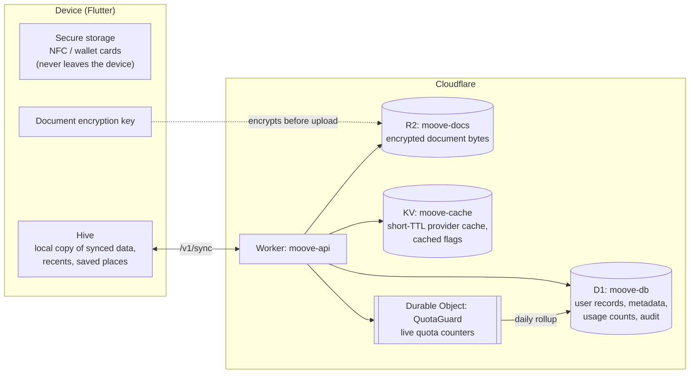
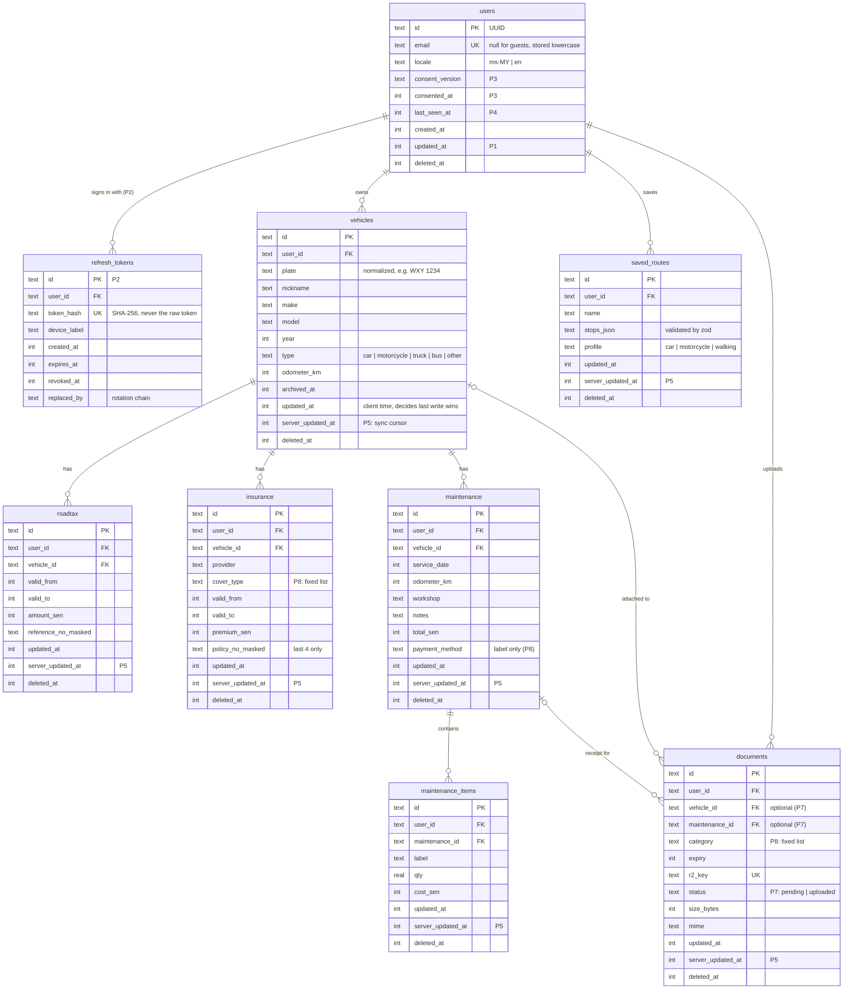
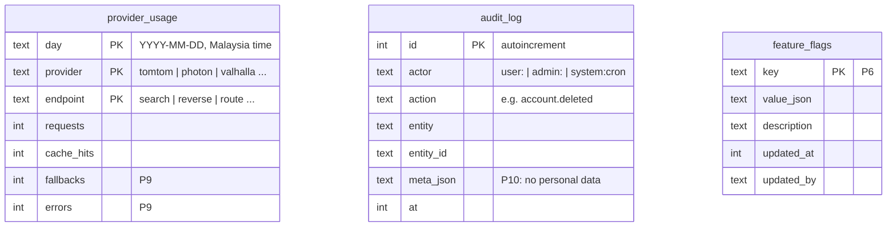
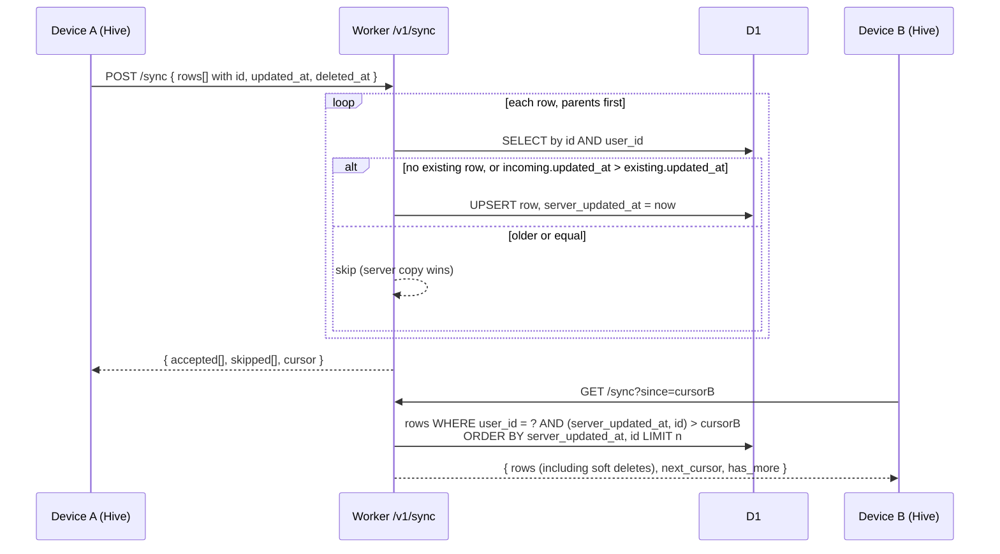
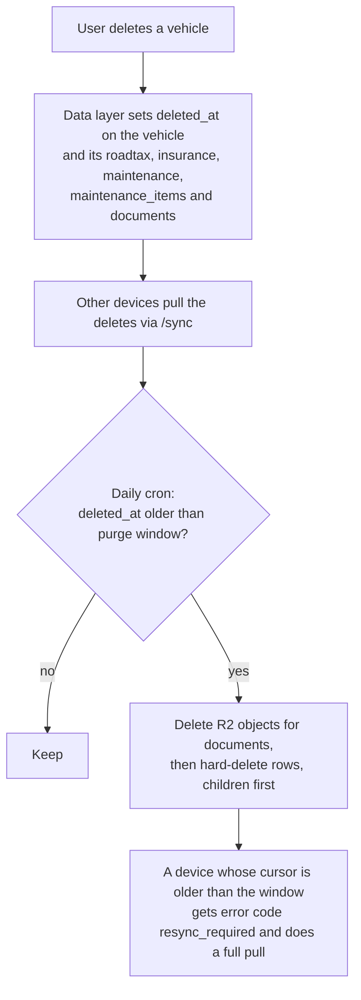
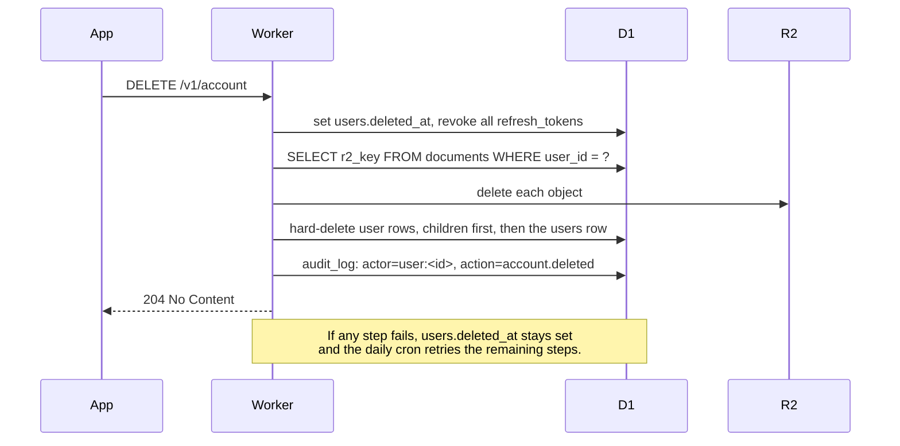
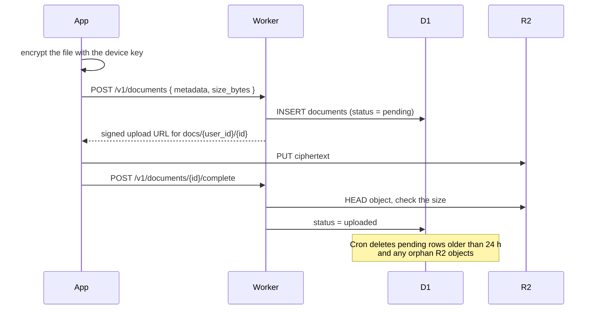

# Moove Database Plan

Date: 18 November 2026 · Status: **draft, waiting for approval**
Audience: developers and AI agents building Phase 1 and Phase 2.
Based on: [BACKEND_MASTER_PLAN.md](../BACKEND_MASTER_PLAN.md), sections 3, 4, 6 and 7.

> **How to read this.** Sections 1–3 give the big picture. Section 4 is the table reference. Section 5 lists every change from the master plan's schema. Each change is labelled **P1, P2…** and needs approval. Until a change is approved, the master plan's schema wins. Section 11 is the draft `0001_init.sql`.

---

## 1. Where data lives



| Store | Holds | Never holds |
|---|---|---|
| **D1** | Users, vehicles, roadtax, insurance, maintenance, document metadata, saved routes, usage counts, audit log, feature flags | Card numbers, NFC payloads, wallet balances, full policy or reference numbers, provider response bodies |
| **R2** | Encrypted document bytes (ciphertext only) | Plaintext documents |
| **KV** | Short-lived provider cache (TTL from plan 5.3), cached config | Anything that must be durable or consistent |
| **Durable Object** | Live quota counters, and rate-limit counters if approved (P11) | User data |
| **Device only** | NFC and wallet cards, the document encryption key, recents, saved places (for now) | — |

---

## 2. Entity relationship diagram

Tables and columns marked *(P#)* are proposals from section 5.



Global tables that do not belong to one user and have no relationships:



---

## 3. Shared rules for every table

1. **IDs are UUIDs** (text), generated by the client for synced rows. The exception is `audit_log`, which is append-only and never synced.
2. **Timestamps are integer Unix milliseconds** (P12), matching JavaScript `Date.now()` and Dart `millisecondsSinceEpoch`.
3. **Money is integer sen.** RM 12.50 is stored as `1250`.
4. **Synced tables** (`vehicles`, `roadtax`, `insurance`, `maintenance`, `maintenance_items`, `documents`, `saved_routes`) all have the same sync columns:
   - `user_id`: the owner, set by the server from the access token and never trusted from the request body.
   - `updated_at`: set by the client. It decides last write wins.
   - `server_updated_at`: set by the server on every write. It is the sync cursor (P5).
   - `deleted_at`: soft delete. The row stays so the delete can sync to other devices.
5. **User scoping.** Every query on a user table filters by `user_id` inside `src/data/`. Global tables (`provider_usage`, `audit_log`, `feature_flags`) are reached only through system or admin functions in `src/data/`, never from user-facing handlers.
6. **Never stored on the server:** card numbers, NFC payloads, wallet balances, full policy or reference numbers, or provider response bodies.

---

## 4. Table reference

### 4.1 `users`
One row per guest or registered user.

| Column | Type | Null | Notes |
|---|---|---|---|
| id | TEXT | no | UUID, primary key |
| email | TEXT | yes | Unique and stored lowercase. Null for guests. SQLite allows many nulls in a unique column. |
| locale | TEXT | no | `ms-MY` (default) or `en` |
| consent_version | TEXT | yes | **P3.** Version of the PDPA consent text the user accepted |
| consented_at | INTEGER | yes | **P3.** When they accepted it. Required before upgrading to an account. |
| last_seen_at | INTEGER | yes | **P4.** Used to clean up abandoned guests |
| created_at | INTEGER | no | |
| updated_at | INTEGER | no | **P1** |
| deleted_at | INTEGER | yes | Set while account deletion is in progress (see 6.3) |

### 4.2 `refresh_tokens` (P2)
Refresh tokens issued by `/auth/guest`, `/auth/upgrade` and `/auth/refresh`. Access tokens are short-lived JWTs and are **not** stored.

| Column | Type | Null | Notes |
|---|---|---|---|
| id | TEXT | no | UUID |
| user_id | TEXT | no | FK `users.id` |
| token_hash | TEXT | no | SHA-256 of the token. Unique. The raw token is never stored. |
| device_label | TEXT | yes | e.g. "Pixel 8". Lets users see their sessions later. |
| created_at, expires_at | INTEGER | no | |
| revoked_at | INTEGER | yes | Set on logout, rotation or account deletion |
| replaced_by | TEXT | yes | Next token id in the rotation chain. If a revoked token is reused, revoke the whole chain. |

### 4.3 `vehicles`
| Column | Type | Null | Notes |
|---|---|---|---|
| id, user_id | TEXT | no | |
| plate | TEXT | no | Normalized in the data layer: uppercase, single spaces (`wxy1234` → `WXY 1234`). Unique per user among rows that are not deleted (P13). |
| nickname, make, model | TEXT | yes | |
| year | INTEGER | yes | |
| type | TEXT | yes | `car`, `motorcycle`, `truck`, `bus`, `other` |
| odometer_km | INTEGER | yes | ≥ 0 |
| archived_at | INTEGER | yes | Hidden from lists but kept, for example a sold car |
| sync columns | | | See section 3 |

### 4.4 `roadtax`
| Column | Type | Null | Notes |
|---|---|---|---|
| id, user_id, vehicle_id | TEXT | no | `vehicle_id` FK `vehicles.id` |
| valid_from | INTEGER | yes | |
| valid_to | INTEGER | no | Drives renewal reminders |
| amount_sen | INTEGER | yes | ≥ 0 |
| reference_no_masked | TEXT | yes | Masked, e.g. `****5678` |
| sync columns | | | |

### 4.5 `insurance`
| Column | Type | Null | Notes |
|---|---|---|---|
| id, user_id, vehicle_id | TEXT | no | |
| provider | TEXT | yes | Insurer name |
| cover_type | TEXT | yes | **P8:** `comprehensive`, `third_party`, `third_party_fire_theft`, `other` |
| valid_from | INTEGER | yes | |
| valid_to | INTEGER | no | Drives renewal reminders |
| premium_sen | INTEGER | yes | ≥ 0 |
| policy_no_masked | TEXT | yes | Last 4 only |
| sync columns | | | |

### 4.6 `maintenance` and `maintenance_items`
`maintenance` is one service visit. `maintenance_items` are its line items (oil, filter, labour…).

| Column | Type | Null | Notes |
|---|---|---|---|
| service_date | INTEGER | no | |
| odometer_km | INTEGER | yes | |
| workshop, notes | TEXT | yes | |
| total_sen | INTEGER | yes | Entered by the user. Not forced to equal the sum of the items. |
| payment_method | TEXT | yes | **P8:** label only: `cash`, `card`, `ewallet`, `fpx`, `other`. Never card details. |
| *items:* label | TEXT | no | |
| *items:* qty | REAL | yes | Real number for amounts like 4.5 litres |
| *items:* cost_sen | INTEGER | yes | |

### 4.7 `documents`
Metadata only. The bytes are in R2 as ciphertext.

| Column | Type | Null | Notes |
|---|---|---|---|
| vehicle_id, maintenance_id | TEXT | yes | Optional links, with foreign keys (**P7**) |
| category | TEXT | yes | **P8:** `roadtax`, `insurance`, `receipt`, `licence`, `other` |
| expiry | INTEGER | yes | e.g. licence expiry |
| r2_key | TEXT | no | `docs/{user_id}/{document_id}`. Unique. |
| status | TEXT | no | **P7:** `pending` until the upload is confirmed, then `uploaded` |
| size_bytes | INTEGER | yes | Limit to be decided (section 10) |
| mime | TEXT | yes | Type of the original file, before encryption |

### 4.8 `saved_routes` ("roadmap")
| Column | Type | Null | Notes |
|---|---|---|---|
| name | TEXT | yes | |
| stops_json | TEXT | no | JSON array: `[{ "name": "...", "lat": 3.1, "lon": 101.6 }]`. Validated by zod, with a maximum number of stops. |
| profile | TEXT | yes | `car`, `motorcycle`, `walking` |

### 4.9 `provider_usage`
Daily counts per provider and endpoint. The `QuotaGuard` Durable Object holds the live counters, and the cron job rolls them up into this table. Counts only, never payloads.

### 4.10 `audit_log`
Append-only. Records sign-ups, upgrades, account deletions, admin flag changes and admin views of user data. `meta_json` (P10) must not contain personal data such as emails or plates. Use ids only.

### 4.11 `feature_flags` (P6)
Backs `GET /config` (Phase 1) and the admin flags screen (Phase 4), for example `map_provider_default`, `min_app_version` and `tomtom_enabled`. Cached in KV for about 60 seconds.

---

## 5. Changes from the master plan schema (need approval)

| # | Change | Why |
|---|---|---|
| **P1** | Add `updated_at` to `users` | The master plan's own rule is "every row carries `updated_at`". Needed when locale or email changes. |
| **P2** | New table `refresh_tokens` | Phase 1 needs token refresh, logout and revocation on account deletion. That needs a stored, hashed token. |
| **P3** | Add `consent_version` and `consented_at` to `users` | PDPA consent screen before account creation (plan section 4). Records what the user agreed to and when. |
| **P4** | Add `last_seen_at` to `users` | Guest rows pile up. Lets the cron job remove guests that are inactive and have no data. |
| **P5** | Add `server_updated_at` to every synced table and use it as the sync cursor | `updated_at` comes from the device clock. If `GET /sync?since=` filtered on it, a row written late with an older device time would never reach other devices. The server time fixes this. `updated_at` still decides last write wins. |
| **P6** | New table `feature_flags` | `/config` needs a home, and admins must be able to change flags (Phase 4) with an audit trail. |
| **P7** | Add `documents.status`, and foreign keys on `documents.vehicle_id` and `documents.maintenance_id` | The signed-upload flow has two steps (6.4). Foreign keys stop links to rows that don't exist. |
| **P8** | CHECK lists for `insurance.cover_type`, `maintenance.payment_method`, `documents.category` and `saved_routes.profile` | Stops free-text drift and makes admin reports and Malay labels possible. |
| **P9** | Add `fallbacks` and `errors` to `provider_usage` | The Phase 3 deliverable asks for proof of fallback and quota behaviour. |
| **P10** | Add `meta_json` to `audit_log`, plus indexes | Context for entries such as which flag changed and the old and new values. Indexes for the admin audit screen. |
| **P11** | Rate-limit counters in a Durable Object or Cloudflare's rate-limiting binding, **not KV** | KV is eventually consistent and limits its write rate, so it miscounts quick bursts (VERIFY current KV limits). |
| **P12** | Timestamps in **milliseconds** | One unit everywhere, and it matches the Dart and JS defaults. The master plan doesn't say which unit. |
| **P13** | Replace `UNIQUE (user_id, plate)` with a **partial** unique index `WHERE deleted_at IS NULL` | With soft deletes, the original rule blocks a user from deleting a car and adding the same plate again. |
| **P14** | Replace `idx_vehicles_user` with `(user_id, server_updated_at)` sync indexes on every synced table | `GET /sync` is the hottest query. One index per table serves both lists and sync. |

---

## 6. Key flows

### 6.1 Sync (last write wins)



Rules:
- **Parents first** in a push batch: `vehicles` → `roadtax`, `insurance`, `maintenance` → `maintenance_items` → `documents`. `saved_routes` can go in any order. Otherwise the foreign keys fail.
- **The cursor is `(server_updated_at, id)`**, not the timestamp alone. Rows written in the same millisecond can't be lost at a page boundary.
- **Ownership check:** if a row id already exists under a different `user_id`, reject it. Never overwrite another user's row.
- **Ties** (equal `updated_at`): the server copy wins.
- **Guests:** under D6, guests don't sync. `/sync` requires an upgraded account (to confirm in section 10).

### 6.2 Soft delete and purge



Proposed purge window: **30 days**.

### 6.3 Account deletion (PDPA)



Account deletion is a **hard** delete, not a soft one. The audit entry keeps only the user's UUID.

### 6.4 Document upload



---

## 7. Indexes

| Index | Columns | Used by |
|---|---|---|
| `idx_<table>_sync` (each synced table) | `(user_id, server_updated_at, id)` | `GET /sync`, user lists |
| `uq_vehicles_user_plate` | `(user_id, plate) WHERE deleted_at IS NULL` | Plate uniqueness |
| `idx_roadtax_due` | `(valid_to) WHERE deleted_at IS NULL` | Reminder cron |
| `idx_insurance_due` | `(valid_to) WHERE deleted_at IS NULL` | Reminder cron |
| `idx_roadtax_vehicle`, `idx_insurance_vehicle` | `(vehicle_id)` | Vehicle detail screen, cascade delete |
| `idx_maintenance_veh` | `(vehicle_id, service_date)` | Service history |
| `idx_items_maintenance` | `(maintenance_id)` | Line items |
| `idx_documents_vehicle` | `(vehicle_id)` | Vehicle documents |
| `idx_refresh_user` | `(user_id)` | Revoke all sessions |
| `idx_users_guest_cleanup` | `(last_seen_at) WHERE email IS NULL` | Guest cleanup |
| `idx_audit_entity`, `idx_audit_at` | `(entity, entity_id)`, `(at)` | Admin audit screen |
| `idx_documents_deleted` and similar | `(deleted_at) WHERE deleted_at IS NOT NULL` | Purge cron (add if the purge is slow) |

The master plan's `idx_roadtax_user_due` is dropped. The sync index already covers per-user lookups, and per-user lists are small.

---

## 8. KV, R2 and Durable Object keys

| Store | Key pattern | TTL / lifetime |
|---|---|---|
| KV `CACHE` | `rev:{geohash6}:{lang}`, `geo:{query}:{lang}`, `srch:{query}:{geohash5}:{lang}`, `rt:{profile}:{o}:{d}:{opts}` | From plan 5.3, capped by the TomTom terms (Phase 0) |
| KV `CACHE` | `cfg:flags` | About 60 s. Cleared when an admin changes a flag. |
| R2 `DOCS` | `docs/{user_id}/{document_id}` | Until the document or account is deleted |
| R2 `PACKS` (later) | `packs/{region}/{version}.pmtiles` | Phase 6 |
| DO `QuotaGuard` | one instance per provider; counters keyed `{day}:{endpoint}` | Rolled into `provider_usage` daily |

---

## 9. Migrations

- Files live in `backend/migrations/`: `0001_init.sql`, `0002_...sql`. They are applied with `wrangler d1 migrations apply`.
- **Never edit a migration that has been applied.** Add a new file instead.
- Order: `--local`, then staging, then production. A human runs production.
- Every migration that adds a synced table must also add the sync columns and the sync index.
- D1 foreign-key enforcement: **VERIFY** whether it is on by default, and test that a bad `vehicle_id` is rejected.
- Planned migrations:

| File | Phase | Contents |
|---|---|---|
| `0001_init.sql` | 1 | All tables in section 11. Unused tables are fine to create early. |
| `0002_...` | 3 | Changes found during the TomTom work, if any |
| later | 5–6 | Transit stops (geohash), road reports, contributions, votes, moderation queue. Designed in their own phase. |

---

## 10. Open questions

1. **Approve P1–P14** (section 5), or say which to drop.
2. **Documents on a second device.** Files are encrypted with a key that lives on the device. How does a new device get the key? Options: a key derived from a user passphrase, a recovery code, or "documents stay on one device". **This blocks the Phase 2 "two devices sync" deliverable for documents.**
3. **Guest data.** Confirm that guests never sync, so `/sync` and `/documents` require an upgraded account.
4. **Purge window** for soft-deleted rows: 30 days?
5. **Guest cleanup**: delete guests with no email and no activity for 90 days?
6. **Audit log retention**: how long to keep entries such as 1 year? This is a PDPA question.
7. **Document limits**: maximum file size and maximum files per user.
8. **Reminders** (master plan question 5): if server push is chosen, add a `push_tokens` table in Phase 2.

---

## 11. Draft `0001_init.sql`

This includes all proposals. If a proposal is rejected, remove its lines before Phase 1.

```sql
-- users and auth ---------------------------------------------------------
CREATE TABLE users (
  id              TEXT PRIMARY KEY,
  email           TEXT UNIQUE,
  locale          TEXT NOT NULL DEFAULT 'ms-MY' CHECK (locale IN ('ms-MY','en')),
  consent_version TEXT,
  consented_at    INTEGER,
  last_seen_at    INTEGER,
  created_at      INTEGER NOT NULL,
  updated_at      INTEGER NOT NULL,
  deleted_at      INTEGER
);

CREATE TABLE refresh_tokens (
  id           TEXT PRIMARY KEY,
  user_id      TEXT NOT NULL REFERENCES users(id),
  token_hash   TEXT NOT NULL UNIQUE,
  device_label TEXT,
  created_at   INTEGER NOT NULL,
  expires_at   INTEGER NOT NULL,
  revoked_at   INTEGER,
  replaced_by  TEXT
);

-- vehicle records (synced) -----------------------------------------------
CREATE TABLE vehicles (
  id                TEXT PRIMARY KEY,
  user_id           TEXT NOT NULL REFERENCES users(id),
  plate             TEXT NOT NULL,
  nickname TEXT, make TEXT, model TEXT, year INTEGER,
  type              TEXT CHECK (type IN ('car','motorcycle','truck','bus','other')),
  odometer_km       INTEGER CHECK (odometer_km >= 0),
  archived_at       INTEGER,
  updated_at        INTEGER NOT NULL,
  server_updated_at INTEGER NOT NULL,
  deleted_at        INTEGER
);

CREATE TABLE roadtax (
  id                  TEXT PRIMARY KEY,
  user_id             TEXT NOT NULL REFERENCES users(id),
  vehicle_id          TEXT NOT NULL REFERENCES vehicles(id),
  valid_from          INTEGER,
  valid_to            INTEGER NOT NULL,
  amount_sen          INTEGER CHECK (amount_sen >= 0),
  reference_no_masked TEXT,
  updated_at          INTEGER NOT NULL,
  server_updated_at   INTEGER NOT NULL,
  deleted_at          INTEGER
);

CREATE TABLE insurance (
  id                TEXT PRIMARY KEY,
  user_id           TEXT NOT NULL REFERENCES users(id),
  vehicle_id        TEXT NOT NULL REFERENCES vehicles(id),
  provider          TEXT,
  cover_type        TEXT CHECK (cover_type IN ('comprehensive','third_party','third_party_fire_theft','other')),
  valid_from        INTEGER,
  valid_to          INTEGER NOT NULL,
  premium_sen       INTEGER CHECK (premium_sen >= 0),
  policy_no_masked  TEXT,               -- last 4 only
  updated_at        INTEGER NOT NULL,
  server_updated_at INTEGER NOT NULL,
  deleted_at        INTEGER
);

CREATE TABLE maintenance (
  id                TEXT PRIMARY KEY,
  user_id           TEXT NOT NULL REFERENCES users(id),
  vehicle_id        TEXT NOT NULL REFERENCES vehicles(id),
  service_date      INTEGER NOT NULL,
  odometer_km       INTEGER CHECK (odometer_km >= 0),
  workshop TEXT, notes TEXT,
  total_sen         INTEGER CHECK (total_sen >= 0),
  payment_method    TEXT CHECK (payment_method IN ('cash','card','ewallet','fpx','other')),  -- label only
  updated_at        INTEGER NOT NULL,
  server_updated_at INTEGER NOT NULL,
  deleted_at        INTEGER
);

CREATE TABLE maintenance_items (
  id                TEXT PRIMARY KEY,
  user_id           TEXT NOT NULL REFERENCES users(id),
  maintenance_id    TEXT NOT NULL REFERENCES maintenance(id),
  label             TEXT NOT NULL,
  qty               REAL,
  cost_sen          INTEGER CHECK (cost_sen >= 0),
  updated_at        INTEGER NOT NULL,
  server_updated_at INTEGER NOT NULL,
  deleted_at        INTEGER
);

CREATE TABLE documents (                -- metadata only; ciphertext is in R2
  id                TEXT PRIMARY KEY,
  user_id           TEXT NOT NULL REFERENCES users(id),
  vehicle_id        TEXT REFERENCES vehicles(id),
  maintenance_id    TEXT REFERENCES maintenance(id),
  category          TEXT CHECK (category IN ('roadtax','insurance','receipt','licence','other')),
  expiry            INTEGER,
  r2_key            TEXT NOT NULL UNIQUE,
  status            TEXT NOT NULL DEFAULT 'pending' CHECK (status IN ('pending','uploaded')),
  size_bytes        INTEGER CHECK (size_bytes >= 0),
  mime              TEXT,
  updated_at        INTEGER NOT NULL,
  server_updated_at INTEGER NOT NULL,
  deleted_at        INTEGER
);

CREATE TABLE saved_routes (             -- "roadmap"
  id                TEXT PRIMARY KEY,
  user_id           TEXT NOT NULL REFERENCES users(id),
  name              TEXT,
  stops_json        TEXT NOT NULL,
  profile           TEXT CHECK (profile IN ('car','motorcycle','walking')),
  updated_at        INTEGER NOT NULL,
  server_updated_at INTEGER NOT NULL,
  deleted_at        INTEGER
);

-- global tables ----------------------------------------------------------
CREATE TABLE provider_usage (           -- counts only, no payloads
  day        TEXT NOT NULL,
  provider   TEXT NOT NULL,
  endpoint   TEXT NOT NULL,
  requests   INTEGER NOT NULL DEFAULT 0,
  cache_hits INTEGER NOT NULL DEFAULT 0,
  fallbacks  INTEGER NOT NULL DEFAULT 0,
  errors     INTEGER NOT NULL DEFAULT 0,
  PRIMARY KEY (day, provider, endpoint)
);

CREATE TABLE audit_log (
  id        INTEGER PRIMARY KEY AUTOINCREMENT,
  actor     TEXT NOT NULL,
  action    TEXT NOT NULL,
  entity    TEXT,
  entity_id TEXT,
  meta_json TEXT,                       -- never personal data
  at        INTEGER NOT NULL
);

CREATE TABLE feature_flags (
  key         TEXT PRIMARY KEY,
  value_json  TEXT NOT NULL,
  description TEXT,
  updated_at  INTEGER NOT NULL,
  updated_by  TEXT
);

-- indexes ----------------------------------------------------------------
CREATE UNIQUE INDEX uq_vehicles_user_plate ON vehicles(user_id, plate) WHERE deleted_at IS NULL;

CREATE INDEX idx_vehicles_sync     ON vehicles(user_id, server_updated_at, id);
CREATE INDEX idx_roadtax_sync      ON roadtax(user_id, server_updated_at, id);
CREATE INDEX idx_insurance_sync    ON insurance(user_id, server_updated_at, id);
CREATE INDEX idx_maintenance_sync  ON maintenance(user_id, server_updated_at, id);
CREATE INDEX idx_items_sync        ON maintenance_items(user_id, server_updated_at, id);
CREATE INDEX idx_documents_sync    ON documents(user_id, server_updated_at, id);
CREATE INDEX idx_routes_sync       ON saved_routes(user_id, server_updated_at, id);

CREATE INDEX idx_roadtax_due       ON roadtax(valid_to)   WHERE deleted_at IS NULL;
CREATE INDEX idx_insurance_due     ON insurance(valid_to) WHERE deleted_at IS NULL;
CREATE INDEX idx_roadtax_vehicle   ON roadtax(vehicle_id);
CREATE INDEX idx_insurance_vehicle ON insurance(vehicle_id);
CREATE INDEX idx_maintenance_veh   ON maintenance(vehicle_id, service_date);
CREATE INDEX idx_items_maintenance ON maintenance_items(maintenance_id);
CREATE INDEX idx_documents_vehicle ON documents(vehicle_id);

CREATE INDEX idx_refresh_user          ON refresh_tokens(user_id);
CREATE INDEX idx_users_guest_cleanup   ON users(last_seen_at) WHERE email IS NULL;
CREATE INDEX idx_audit_entity          ON audit_log(entity, entity_id);
CREATE INDEX idx_audit_at              ON audit_log(at);
```
